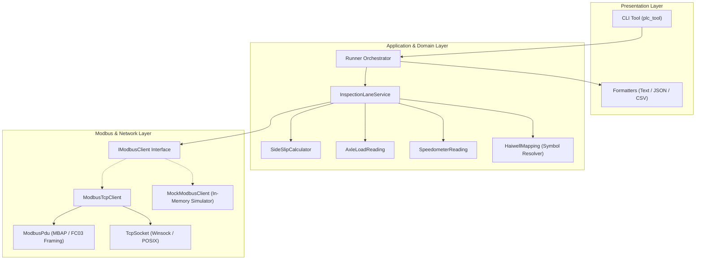

# plc-modbus-tool

> High-performance C++20 tooling for PLC Modbus TCP communication and automated vehicle inspection lane telemetry.

[](https://github.com/RichardLitt/standard-readme)
[](https://isocpp.org/)
[](https://cmake.org/)
[](https://www.docker.com/)
[](LICENSE)

A clean-sheet modern C++20 rewrite of industrial PLC Modbus data acquisition and testing tooling. Replaces legacy single-file scripts with a modular, highly performant, containerized architecture featuring automated unit testing, high-resolution microbenchmarking, and strict separation of concerns.

## Table of Contents

- [Background](#background)
- [Sustainable Development](#sustainable-development)
- [Architecture](#architecture)
- [Install](#install)
  - [Prerequisites](#prerequisites)
  - [Native Build (Windows / Linux)](#native-build-windows--linux)
  - [Docker Build](#docker-build)
- [Usage](#usage)
  - [CLI Overview](#cli-overview)
  - [Station Telemetry Snapshot (`lane`)](#station-telemetry-snapshot-lane)
  - [Continuous Real-Time Streaming](#continuous-real-time-streaming)
  - [Direct Register & Symbol Query (`read`)](#direct-register--symbol-query-read)
  - [Register Range Scanner & Fingerprinter (`probe`)](#register-range-scanner--fingerprinter-probe)
  - [Performance Benchmarking (`benchmark`)](#performance-benchmarking-benchmark)
- [Testing](#testing)
- [Benchmarking](#benchmarking)
- [PLC Register Map](#plc-register-map)
- [Maintainers](#maintainers)
- [Contributing](#contributing)
- [License](#license)

## Background

Industrial vehicle testing lanes (such as vehicle periodic inspection stations / PKB) rely on Programmable Logic Controllers (PLCs) like the Haiwell PLC to coordinate sensor instrumentation:
- **Side Slip Tester:** Analog lateral tire deviation sensor (linear potentiometer/ADC).
- **Axle Load / Weighing & Brake Station:** Dual-channel load cells (Left CH1 and Right CH2) measuring dynamic weight, wheel braking imbalance, and latched axle loads (Sumbu 1 to 4).
- **Speedometer Tester:** High-Speed Counter (HSC) reading optical rotary encoder pulses to evaluate vehicle speed accuracy.

The original project codebase consisted of ad-hoc Python scripts (`main.py`, `blind_probe.py`) bundled via PyInstaller into bloated (~8 MB) executables with no automated tests, no performance metrics, and tight coupling between network I/O and register parsing.

`plc-modbus-tool` is a ground-up reboot written in modern C++20. It eliminates legacy dependencies, retains 100% of the industrial domain logic flow, and introduces native binary performance, zero-dependency socket abstractions, structured unit testing, microbenchmarks, and containerized deployment.

## Sustainable Development

This project was engineered adhering to sustainable and green software engineering principles:

- **Resource & Compute Efficiency:**
  - Written in pure standard C++20 with zero heavy third-party framework overhead.
  - Achieves over 40 million Modbus frames/sec and 600+ million calculation operations/sec on standard consumer hardware.
  - Memory footprint is under 3 MB at runtime (compared to >40 MB for Python runtimes).
- **Network & Hardware Longevity:**
  - Employs non-busy, event-driven socket timeouts and configurable polling intervals to prevent network congestion and protect embedded PLC CPUs from bus saturation.
  - Connection pooling with `TCP_NODELAY` avoids TCP retransmission storms and reduces energy consumption across edge hardware.
- **Maintainable & Extensible Lifecycle:**
  - Strict **Separation of Concerns (SoC)** and Clean Architecture ensure new PLC protocols, station sensors, or fieldbuses can be added without altering network or formatting layers.
- **Ultra-Lean Container Footprint:**
  - Multi-stage Docker build produces a hardened, non-root Alpine container under 15 MB.

## Architecture

The project adheres strictly to layered separation of concerns:

```
include/plc/
├── core/         # Types, Endianness (be16/be32), Result<T, Error>, Logger
├── network/      # Cross-platform socket abstraction (Winsock / POSIX)
├── modbus/       # Modbus PDU encoding, MBAP framing, TCP & Mock clients
├── domain/       # Haiwell mapping, Side Slip scaling, Axle Load, Speedometer
└── app/          # CLI argument parser, Multi-format formatters (Text/JSON/CSV), Runner
```



## Install

### Prerequisites

- **C++ Compiler:** Supporting C++20 (MSVC 2022/2026, GCC 11+, or Clang 13+)
- **Build System:** [CMake](https://cmake.org/) (>= 3.20)
- **Container Engine (Optional):** [Docker](https://www.docker.com/) and Docker Compose

### Native Build (Windows / Linux)

```bash
# 1. Clone repository
git clone https://github.com/example/plc-modbus-tool.git
cd plc-modbus-tool

# 2. Configure project via CMake
cmake -B build -S . -DCMAKE_BUILD_TYPE=Release

# 3. Build executable, unit tests, and benchmarks
cmake --build build --config Release
```

On Windows, compiled binaries are generated in:
- `build/Release/plc_tool.exe`
- `build/tests/Release/plc_tests.exe`
- `build/benchmarks/Release/plc_benchmarks.exe`

On Linux / macOS:
- `build/plc_tool`
- `build/tests/plc_tests`
- `build/benchmarks/plc_benchmarks`

### Docker Build

Build the container image and execute tests in a single command:

```bash
# Build multi-stage Docker image (runs automated unit tests during build)
docker build -t plc-modbus-tool:latest .
```

Or using Docker Compose:

```bash
# Start continuous lane telemetry
docker compose up plc-tool

# Run mock demo without physical PLC hardware
docker compose run --rm plc-mock-demo
```

## Usage

### CLI Overview

```
Usage: plc_tool [command] [options]

Commands:
  lane           Read snapshot or stream live readings for vehicle inspection lane (default)
  read           Read holding registers by address, symbol (e.g. V1110), or station
  probe          Probe register range to detect active, non-zero, or fluctuating registers
  benchmark      Run built-in communication / parsing throughput benchmarks
  help           Display this help screen
  version        Display version information

Options:
  --host <ip>             PLC IP address (default: 192.168.70.111 or $PLC_HOST)
  --port <port>           PLC Modbus TCP port (default: 502 or $PLC_PORT)
  --unit <id>             Modbus Slave / Unit ID (default: 1 or $PLC_UNIT_ID)
  --timeout <ms>          Socket connection/read timeout in milliseconds (default: 3000)
  --addr <n>              Starting register address for 'read' command
  --count <n>             Number of registers to read (default: 1)
  --symbol <sym>          Read by Haiwell symbol (e.g. V1110, V1232, AI0)
  --station <name>        Read specific station: sideslip | axle | speed
  --addressing <mode>     Addressing mode: 'direct' (V<n>=n) or 'haiwell-offset' (V<n>=512+n)
  --start <n>             Starting address for 'probe' command (default: 0)
  --probe-count <n>       Register count for 'probe' command (default: 2500)
  --format <fmt>          Output format: text | json | csv (default: text)
  -c, --continuous        Stream readings continuously in loop
  --interval <ms>         Streaming refresh interval in milliseconds (default: 1000)
  --mock                  Run against built-in simulated PLC mock
  --verbose               Enable verbose debug logging
```

### Station Telemetry Snapshot (`lane`)

Connects to the PLC, performs synchronized Modbus queries, and presents a complete snapshot of all stations:

```bash
plc_tool lane --host 192.168.70.111
```

Or test instantly offline with the built-in simulator:

```bash
plc_tool lane --mock
```

**Output:**
```text
============================================================
             VEHICLE INSPECTION LANE SNAPSHOT               
============================================================

[1. SIDE SLIP TESTER]
  - Raw ADC (V1110):        131
  - PLC Display (V1100):    0 mm/m
  - Tool Calculated:        -1.31 mm/m
  - Deviation:              1.31 mm/m
  - Calibration (V1102..5): [130, 30, -1, 30]

[2. AXLE LOAD / WEIGHING & BRAKE FORCE (Slot 2)]
  - Left / CH1 Live (V1232):    37 kg  (Avg V1230: 36 kg)
  - Right/ CH2 Live (V1262):  1594 kg  (Avg V1260: 1597 kg)
  - Total Live Axle Weight:   1631 kg
  - Left/Right Difference:  97.7 %
  - Stored Axles (Sumbu 1..4):
      * Sumbu 1 (V50):      1200 kg
      * Sumbu 2 (V51):      1250 kg
      * Sumbu 3 (V52):      0 kg
      * Sumbu 4 (V53):      0 kg
      * Total Gross Weight: 2450 kg

[3. SPEEDOMETER TESTER]
  - Display Speed (V1300):  2820
  - Encoder PPR (V1310):    360 PPR
  - Raw Pulses (V1320):     0
  - Pulse/Min (V1322):      0
  - Calculated Roller RPM:  0.0 RPM
  - Estimated Vehicle Speed:0.0 km/h (roller Ø350mm)
============================================================
```

### Continuous Real-Time Streaming

Stream JSON telemetry at 10 Hz (100 ms interval) for ingestion into databases, dashboards, or message brokers:

```bash
plc_tool lane --continuous --interval 100 --format json
```

### Direct Register & Symbol Query (`read`)

Query individual registers by address or Haiwell symbol:

```bash
# Read Axle Weights Sumbu 1 to 4 (V50..V53)
plc_tool read --symbol V50 --count 4

# Read Side Slip ADC Raw
plc_tool read --symbol V1110 --count 1

# Read specific station group
plc_tool read --station sideslip
```

### Register Range Scanner & Fingerprinter (`probe`)

Scans registers across two temporal snapshots to automatically locate active, non-zero, or fluctuating registers:

```bash
plc_tool probe --start 0 --probe-count 2500
```

### Performance Benchmarking (`benchmark`)

Execute the built-in microbenchmarks directly from the CLI:

```bash
plc_tool benchmark
```

## Testing

The project includes a comprehensive unit testing suite covering PDU encoding, big-endian byte order conversion, Haiwell address translation, domain calibration math, exception handling, and simulated mock I/O.

Run tests using the test binary:

```bash
./build/tests/Release/plc_tests.exe
```

Or using CTest:

```bash
ctest --test-dir build --output-on-failure
```

Or using Docker:

```bash
docker compose run --rm test
```

## Benchmarking

Dedicated microbenchmarks validate high-throughput performance:

```bash
./build/benchmarks/Release/plc_benchmarks.exe
```

**Representative Results (x86_64, Release):**

| Benchmark | Iterations | Avg Latency | Throughput |
| :--- | :--- | :--- | :--- |
| `ModbusPdu::build_request` | 2,000,000 | 24.2 ns | **41,351,363 ops/s** |
| `ModbusPdu::parse_mbap_header` | 5,000,000 | 5.6 ns | **179,166,517 ops/s** |
| `ModbusPdu::parse_payload` (10 regs) | 2,000,000 | 30.5 ns | **32,811,252 ops/s** |
| `MockModbusClient::read` (In-Memory) | 500,000 | 50.0 ns | **19,990,884 reads/s** |
| `SideSlip::calculate_scaled` | 10,000,000 | 1.7 ns | **605,220,633 ops/s** |
| `AxleLoad::side_difference_percent` | 10,000,000 | 1.3 ns | **794,129,793 ops/s** |
| `Speedometer::estimated_kmh` | 10,000,000 | 1.6 ns | **606,089,992 ops/s** |

## PLC Register Map

The tool retains full compatibility with the Haiwell PLC Modbus register layout:

| Station | Measurement | PLC Register | Direct Addr (`0-based`) | Offset Addr (`512+n`) | Format | Notes |
| :--- | :--- | :--- | :--- | :--- | :--- | :--- |
| **Side Slip** | Raw ADC Input | `V1110` / `AI0` | `1110` | `1622` / `0` | `INT16` | Raw sensor count |
| | Scaled Display | `V1100` | `1100` | `1612` | `INT16` | mm/m deviation |
| | Calibration Low | `V1102` / `V1104` | `1102` / `1104` | `1614` / `1616` | `INT16` | Raw Low / Disp Low |
| | Calibration High | `V1103` / `V1105` | `1103` / `1105` | `1615` / `1617` | `INT16` | Raw High / Disp High |
| **Axle Load** | CH1 Left Live | `V1232` | `1232` | `1744` | `INT16` | Realtime weight (kg) |
| | CH1 Left Avg | `V1230` | `1230` | `1742` | `INT16` | Filtered average (kg) |
| | CH2 Right Live | `V1262` | `1262` | `1774` | `INT16` | Realtime weight (kg) |
| | CH2 Right Avg | `V1260` | `1260` | `1772` | `INT16` | Filtered average (kg) |
| | Sumbu 1..4 (Stored) | `V50`..`V53` | `50`..`53` | `562`..`565` | `INT16[4]` | Latched axle weights |
| **Speedometer** | Display Speed | `V1300` | `1300` | `1812` | `INT32` | Display speed value |
| | Encoder PPR | `V1310` | `1310` | `1822` | `INT16` | Pulses per revolution |
| | Raw Pulses | `V1320` | `1320` | `1832` | `INT32` | Raw encoder pulses |
| | Pulse / Minute | `V1322` | `1322` | `1834` | `INT32` | Pulse frequency |

## Maintainers

[@Azar](https://github.com/example)

## Contributing

PRs accepted. Please adhere to the following guidelines:
1. Ensure all code compiles cleanly with `/W4` (MSVC) or `-Wall -Wextra -Wpedantic` (GCC/Clang).
2. Add unit tests for any new domain calculations or protocol logic under `tests/`.
3. Verify that all unit tests pass (`plc_tests`) and microbenchmarks run without regressions.
4. Follow Standard Readme formatting conventions.

Small note: If editing the Readme, please conform to the [standard-readme](https://github.com/RichardLitt/standard-readme) specification.

## License

[MIT](LICENSE) © 2026 PLC Tool Contributors
